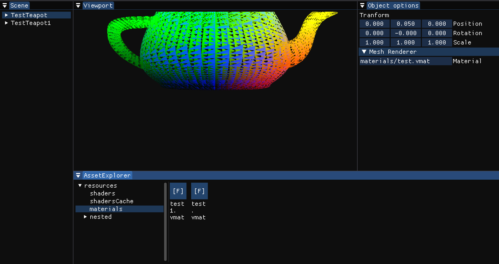

# VoxEngine



VoxEngine is an experimental C++ game engine designed with a focus on a modular architecture and multi-API rendering support. This project represents a personal journey into the complexities of modern graphics programming and engine design.

## Key Features

*   **Multi-Backend Rendering**: The engine is architected to decouple the rendering logic from the underlying graphics API.
    *   **Vulkan**: Current primary and most complete implementation.
    *   **OpenGL**: Architecture ready, implementation planned.
    *   **DirectX 11/12**: Architecture ready, implementation planned.
*   **Extensible Render Graph**: A modern frame graph system that manages resource lifetimes, synchronization, and optimal execution of rendering passes.
*   **Modular Design**: The project is strictly partitioned into logical modules:
    *   `Core`: Essential utilities, data structures, and fundamental abstractions.
    *   `Engine`: The heart of the system, containing the renderer, resource management, and core loop.
    *   `Editor`: A built-in suite of tools for scene inspection and resource management, powered by ImGui.
*   **Platform Abstraction**: Initial focus on Linux support with a clear abstraction layer for future cross-platform portability.
*   **Shader Management**: Integration with SPIRV-Cross for cross-platform shader compilation and reflection.

## Technical Stack

VoxEngine leverages industry-standard libraries to ensure performance and reliability:
*   **Vulkan SDK**: Core graphics API for the primary rendering backend.
*   **ImGui**: Immediate mode GUI for the engine's editor and debugging tools.
*   **CLI11**: Robust command-line argument parsing.
*   **quill**: High-performance, low-latency asynchronous logging library.
*   **yyjson**: The fastest JSON library for resource and configuration handling.
*   **SPIRV-Cross**: Parsing and converting SPIR-V to other shader languages.
*   **GLFW**: Windowing and input handling.

## Project Structure

```text
├── Core        # Base library and common utilities
├── Engine      # Main engine logic and rendering subsystems
├── Editor      # Desktop editor application and GUI tools
```

## Current Status

This is an **early-stage** project. Development is iterative and occurs periodically as a hobby project to explore new architectural patterns or rendering techniques. Current milestones achieved include:
- Functional Vulkan backend with basic synchronization.
- Abstraction layers for buffers, textures, and pipelines.
- Initial Render Graph implementation.
- Basic Editor interface with ImGui integration.

## Getting Started

### Prerequisites
- CMake 3.28+
- C++23 compliant compiler (GCC 13+, Clang 16+)
- Vulkan SDK installed on your system

### Building
```bash
git clone https://github.com/derilh/VoxEngine.git
cd VoxEngine
mkdir build && cd build
cmake -B . -G Ninja ../
make -j$(nproc)
```

### Running

To run the engine (specifically the Editor), you must provide the path to the resources directory. It is also highly recommended to enable the sandbox mode to prevent accidental filesystem changes:

```bash
./bin/VoxEditor --resources ../resources --enable-sandbox
```

*   `--resources <path>`: (Required) Path to the folder containing engine assets and shaders.
*   `--enable-sandbox`: (Recommended) Restricts filesystem access to the current directory for safety.